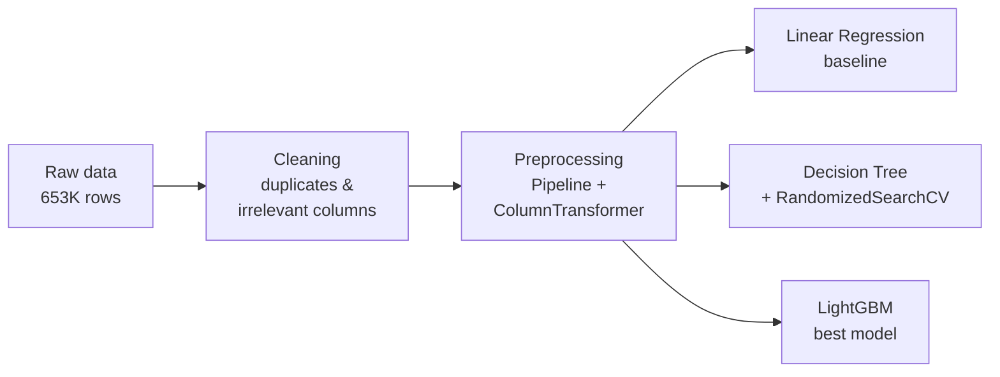

<div align="center">

# 🚗 Turbo.az Car Price Prediction

**Predicting used car prices in Azerbaijan with machine learning**

[](https://www.python.org/)
[](https://scikit-learn.org/)
[](https://lightgbm.readthedocs.io/)
[](https://streamlit.io/)
[](https://pandas.pydata.org/)
[](https://colab.research.google.com/github/mahammadhajiiyev/turbo-az-price-prediction/blob/main/Turbo_az_project.ipynb)

</div>

---

## 📌 Overview

[Turbo.az](https://turbo.az) is Azerbaijan's largest online car marketplace. This project builds a regression model that estimates the **market price of a used car** from its listing details — brand, model, year, mileage, engine, transmission, condition and more.

The project has two parts:

| Part | Files | Result |
|---|---|---|
| 📓 **Research notebook** | `Turbo_az_project.ipynb` | Data exploration and model comparison · LightGBM **R² = 0.925** |
| 🌐 **Web app** | `train.py`, `app.py` | Improved production model · **R² = 0.957**, median error **6.8%** · interactive Streamlit app |

## 🌐 Web app

An interactive **Streamlit** app where anyone can enter a car's details and get an instant price estimate.

- Pick a brand and model — engine size, horsepower, body type, fuel and gearbox are **pre-filled with typical values** for that model
- Get the estimated price together with a **likely price range** (80% of test predictions fall inside it)
- See how your car compares to the **median listing price by year** for the same model
- Works on desktop and mobile, UI in Azerbaijani

### Run it locally

```bash
pip install -r requirements.txt
streamlit run app.py
```

The trained model is already included in `model/`, so the app works without downloading the dataset.

### Retrain the model

```bash
pip install kaggle
python train.py          # downloads the dataset via the Kaggle API and retrains
```

`train.py` repeats the notebook's cleaning steps and adds a few improvements:

| Improvement | Why |
|---|---|
| Uses all ~214K clean listings instead of a 100K sample | More data for rare brands and models |
| Extracts **horsepower** from the engine field | Strong price signal that the notebook did not use |
| Trains on **log(price)** | Keeps very expensive cars from dominating the error |
| Removes obviously invalid listings (year 0, prices below 1,000 AZN) | Cleaner training data |
| Ordinal-encoded categories instead of one-hot + polynomial features | Smaller and faster model (≈6 MB) |

## 📊 Dataset

| | |
|---|---|
| **Source** | [Kaggle — Turbo.az cars project](https://www.kaggle.com/datasets/sehriyarmemmedli/turboaz-cars-project) |
| **Raw size** | 653,721 listings × 56 columns |
| **After cleaning** | 244,263 unique listings |
| **Used for training** | Random sample of 100,000 listings (80/20 train-test split) |
| **Target** | `price_y` — car price |

### Features used

| Group | Features |
|---|---|
| **Car identity** | Brand (`Marka`), model (`Model`), body type (`Ban növü`), production year, number of seats |
| **Technical** | Engine displacement, fuel type (`Yanacaq novu`), transmission (`Sürətlər qutusu`), drivetrain (`Ötürücü`) |
| **Condition & history** | Mileage (`Yürüş`), number of owners (`Sahiblər`), accident history (`Qəzalı`), damage / paint state (`Vəziyyəti`), new or used (`Yeni`) |
| **Listing** | City, color (`Rəng`), target market (`Hansı bazar üçün yığılıb`), barter, dealer (`salon`), VIP / featured flags |

## 🔧 Workflow



1. **Data cleaning** — removed scraping metadata, URLs and image links, unified mileage units, dropped redundant columns and duplicate listings.
2. **Preprocessing** — a single scikit-learn `Pipeline`:
   - *Numeric:* `StandardScaler` → `SimpleImputer(median)` → `PolynomialFeatures(degree=2)`
   - *Categorical:* `OneHotEncoder(handle_unknown='ignore')` → `SimpleImputer(most_frequent)`
3. **Modeling** — three models trained and compared with R², MAE and 3-fold cross-validation.

## 🏆 Results

| Model | Train R² | Test R² | Notes |
|---|:---:|:---:|---|
| Linear Regression (baseline) | 0.851 | 0.834 | CV R² = 0.824 · MAE ≈ 6,457 |
| Decision Tree Regressor | — | — | Tuned with `RandomizedSearchCV` |
| **LightGBM Regressor** ✅ | **0.960** | **0.925** | 500 trees · learning rate 0.05 |

LightGBM improves the test R² by **~9 points** over the linear baseline while keeping the gap between train and test small — the model generalizes well.

### Example prediction

```python
# 2012 Hyundai Accent · sedan · 1.4 L petrol · automatic
# 165,000 km · official dealer car · no accidents · not repainted
full_pipeline_lgbm.predict(sample_input)
# → ≈ 16,040
```

## 🚀 How to run the notebook

1. Click the **Open in Colab** badge above.
2. Upload your Kaggle API key (`kaggle.json`) when prompted — the dataset downloads automatically.
3. Run all cells.

To run locally:

```bash
pip install pandas numpy scikit-learn lightgbm matplotlib seaborn kaggle
jupyter notebook Turbo_az_project.ipynb
```

## 📁 Project structure

```
turbo-az-price-prediction/
├── Turbo_az_project.ipynb   # research: data cleaning, EDA, model comparison
├── train.py                 # trains the production model and exports it to model/
├── app.py                   # Streamlit web app
├── model/
│   ├── model.joblib         # trained pipeline (preprocessing + LightGBM)
│   ├── meta.json            # dropdown options, typical specs per model, metrics
│   └── price_stats.csv      # median price per brand / model / year (for the chart)
├── .streamlit/config.toml   # app theme
├── requirements.txt
└── README.md
```

## 🔮 Future improvements

- Hyperparameter tuning for LightGBM (`num_leaves`, `min_child_samples`, `learning_rate`)
- Retrain on fresh listings so prices follow the current market
- Explain each prediction with SHAP values ("mileage lowered the price by X AZN")
- Use listing photos as an extra input

## 👤 Author

**Mahammad Hajiyev** · [@mahammadhajiiyev](https://github.com/mahammadhajiiyev)
